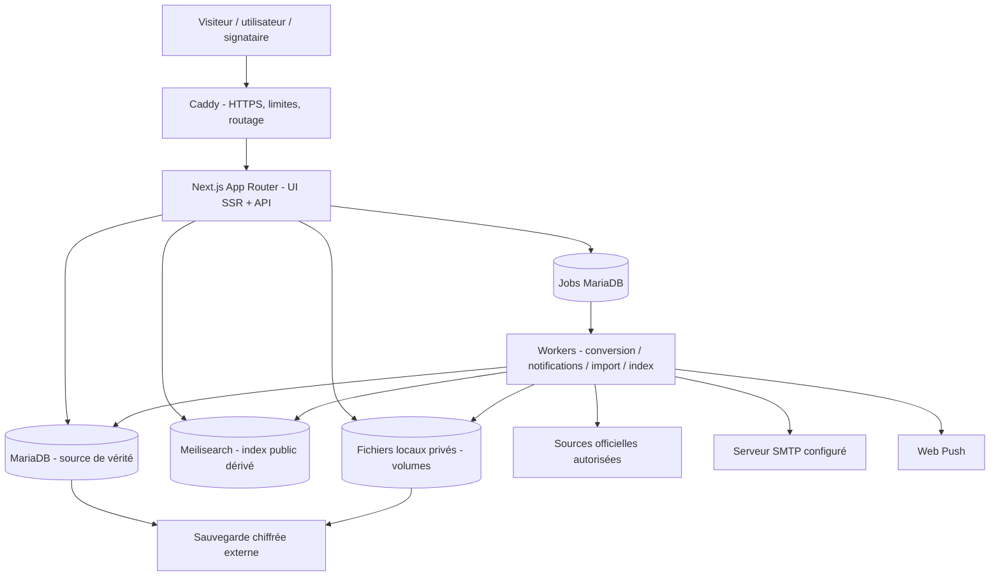

# Architecture technique proposée — Plateforme de documents tunisiens

**Version :** 1.0 — 29 octobre 2026  
**Statut :** architecture recommandée, à approuver avant le prompt d'exécution  
**Source d'autorité :** cahier des charges fonctionnel v1.0, décisions Q1–Q70.

## 1. Arbitrage architectural

**Choix validés :** Next.js + TypeScript, **monolithe modulaire full-stack**, MariaDB, Meilisearch auto-hébergé, files de tâches persistantes en MariaDB (pas Redis obligatoire), stockage local persistant avec interface d'adaptation S3, Docker Compose + Caddy sur VPS OVH existant, dépôt GitHub privé et CI/CD par PR. LLM et API IA **absents à ce stade**. Email via une seule configuration SMTP utilisateur/mot de passe. Mode clair/sombre et localisation FR/AR avec RTL.

**Principe central :** une seule application métier déployable, mais des modules internes indépendants et des **processus workers séparables** pour les tâches lourdes. Il est essentiel de ne pas transformer les routes HTTP Next.js en moteur PDF/OCR/crawler synchrones. Les résultats restent observables dans les tableaux de bord.



Les images, les signatures et les documents ne sont **jamais** servis depuis un dossier public accessible directement par URL prédictible. Les références de fichiers sont opaques, avec contrôle d'autorisation serveur et suivi de téléchargement.

## 2. Découpage fonctionnel en modules à responsabilités claires

| Module | Responsabilités | Dépendances autorisées |
|---|---|---|
| `identity` | Comptes, OAuth Google, magic links, mots de passe, sessions, 2FA, permissions, audit de connexion | DB, SMTP adaptateur |
| `profiles` | Personnes/proches autorisés, données sensibles, choix de profil | identity, DB, crypto |
| `catalog` | Modèles, catégories, types, organismes, publication et traductions | DB, moderation, index outbox |
| `procedures` | Conditions, sources, pièces, checklists, pays/consulats, guides | catalog, DB |
| `search` | Requêtes FR/AR, facettes, synonymes, suggestions, intention à règles | catalog, Meilisearch, DB pour repli |
| `form-engine` | Schémas, règles, validations, calculs, mapping, builder | catalog, profiles, DB |
| `documents` | Brouillons, révisions, rendu, finalisation, suppression, duplication | form-engine, storage, jobs |
| `document-renderer` | PDF, DOCX, impression, template/AcroForm, vérification | documents, worker, fonts |
| `sharing` | ACL, invitation nominative, copie/modification, expiration | identity, documents |
| `signatures` | Signataires, étapes, preuves, version figée, statuts | sharing, documents, SMTP |
| `dossiers` | Pièces jointes, scans, checklist, ZIP/PDF fusionné | procedures, storage, documents |
| `contributions` | Proposition de modèle, demandes et signalement, modération | catalog, identity |
| `sources` | Connecteurs officiels, découvertes, hash, comparaison, vérification | procedures, jobs, storage |
| `notifications` | In-app, SMTP, push, préférences | identity, jobs |
| `analytics` | Comptage agrégé, recherche sans résultat minimisée, suivi technique | DB, opt-in lorsqu'exigé |
| `admin` | Orchestration des fonctions administratives, textes et paramètres | modules métier via interfaces, audit |
| `compliance` | Demandes accès/export/suppression, consentements, politiques, rétention | identity, storage, jobs |
| `platform` | DB, jobs, chiffrement, stockage, audit, limites, configuration, santé | services techniques |

**Règle de dépendance :** les vues Next.js n'écrivent jamais directement dans une table métier. Elles appellent le service d'application qui valide les droits, effectue la transaction et publie un événement outbox pour les traitements asynchrones. Les modèles utilisateurs sont distincts des modèles publics.

## 3. Organisation de fichiers proposée (non existante)

```text
src/
  app/
    [locale]/
      (public)/             accueil, catalogue, guides, pages document
      (auth)/               connexion, inscription, récupération
      (workspace)/          profils, documents, modèles privés, dossiers, notifications
      (admin)/              catalogue, veille, modération, configuration
    api/v1/                 endpoints et webhooks validés
  modules/
    identity/ profiles/ catalog/ procedures/ search/
    form-engine/ documents/ document-renderer/
    sharing/ signatures/ dossiers/ contributions/
    sources/ notifications/ analytics/ admin/ compliance/
  platform/
    database/ authz/ cryptography/ storage/ queue/ audit/ telemetry/
  workers/
    dispatcher/ render/ index/ ingest/ notify/ cleanup/
  design-system/
  localization/
  test/
    fixtures/ integration/ e2e/ accessibility/ visual/
prisma/                     migrations et seed versionné (si ORM Prisma retenu)
public/                     assets publics uniquement ; jamais documents privés
infra/
  docker/ compose/ caddy/ backups/ monitoring/
docs/
  specs/ adr/ runbooks/ api/
```

**RECOMMANDATIONS TECHNIQUES à fixer dans une ADR au démarrage :** ORM Prisma (`provider=mysql`, MariaDB compatible à vérifier sur versions retenues) ou Drizzle ; schémas/validation Zod ; bibliothèque i18n adaptée à App Router (`next-intl` candidate) ; éditeur riche TipTap ou autre éditeur compatible RTL ; bibliothèque DOCX côté worker ; PDF par rendu navigateur contrôlé ou moteur de rendu plus léger si validé par benchmarks. Ces outils ne sont pas des décisions du questionnaire et doivent être évalués sur compatibilité, licence, mémoire, maintenabilité et rendu arabe.

## 4. Modèle de données logique (tables proposées)

Chaque entité porte un identifiant opaque (UUID/ULID), dates UTC, provenance, et informations d'audit pertinentes. MariaDB est la **seule source de vérité** ; Meilisearch ne contient **aucune donnée personnelle**. Les clés étrangères et index sont adaptés à la volumétrie.

### Authentification et personnes

| Tables | Colonnes conceptuelles essentielles |
|---|---|
| `users` | id, email normalisé, statut, langue préférée, thème, date création/suppression |
| `auth_accounts` | id, user_id, provider, provider_subject, métadonnées non sensibles |
| `credentials` | user_id, password_hash, rotation, compteurs défensifs |
| `sessions` | id, user_id, token_hash, device, expiration, revoked_at |
| `verification_challenges` | id, purpose, target_hash, secret_hash, expires_at, used_at, attempts |
| `totp_factors` / `recovery_codes` | user_id, secret chiffré ou hash, activated_at, used_at |
| `roles`, `permissions`, `user_roles` | RBAC, éventuellement contraintes de portée |
| `person_profiles` | owner_user_id, relationship, display_name, données standards et chiffrées, status |
| `profile_authorizations` | profile_id, base/consentement/justificatif si nécessaire, date, révocation |
| `login_events`, `security_events` | événement limité, acteur, horodatage, données minimisées |

### Catalogue et règles documentaires

| Tables | Colonnes conceptuelles essentielles |
|---|---|
| `organizations` | administration/autorité, site, pays/portée, type, état |
| `categories` / `category_translations` | arbre, libellés FR/AR, slugs |
| `tags` / `tag_translations` | alias et termes |
| `document_templates` | id, type, propriétaire éventuel, catégorie principale, visibilité, statut |
| `template_versions` | template_id, version, contenu structuré, version schéma, auteur, digest, statut |
| `template_translations` | version_id, locale, texte validé, statut, réviseur |
| `template_relations` | catégories, organismes, tags, similaires, associations |
| `form_schemas` / `field_definitions` | version_id, json_schema_normalized, traduction, mapping, règles |
| `procedure_guides` / `procedure_versions` | portée, statut, périmètre géographique, horodatage de vérification |
| `procedure_requirements` | conditions structurées, coût/délai avec unité/source si avérés |
| `procedure_template_links` | procedure_version_id, template_version_id, relation |
| `source_records` | URL canonique, source officielle, droits réutilisation, disponibilité |
| `source_observations` | source_id, timestamp, ETag/hash, payload technique et état |
| `source_discoveries` | état de revue, nouveauté/version/doublon, comparatif |
| `model_contributions` / `moderation_cases` | auteur, lien, statut, justification, actions, historique |
| `search_aliases` / `search_intents` | langue, synonymes, expressions, cible, version, statut |

**Point clé :** un `template_version` n'est pas le même objet qu'une `procedure_version`. Une procédure peut utiliser plusieurs modèles ; une source peut concerner plusieurs démarches. Les originaux PDF sont référencés séparément, avec statut de réutilisation.

### Espaces personnels, dossiers et signatures

| Tables | Colonnes conceptuelles essentielles |
|---|---|
| `user_documents` | owner_id, template_version_id nullable pour modèle privé, titre, statut, dossier, deleted_at |
| `document_revisions` | document_id, seq, structured_content, form_answers chiffrées si sensibles, checksum, auteur, created_at |
| `document_render_jobs` | revision_id, format, locale, layout, status, file_ref temporaire, erreur typée |
| `private_templates` | owner_id, source_document_id facultatif, statut |
| `folders` | owner_id, parent_id, label, archive |
| `dossiers` | owner_id, procedure_version_id, état, commentaire |
| `dossier_items` | dossier_id, type, source_ref, requirement_ref, état |
| `stored_files` | owner_id, adapter, object_key, type déclaré et détecté, digest, taille, scan_status, chiffrement |
| `file_references` | file_id, destination (document/profil/dossier), but d'utilisation |
| `share_grants` | resource_ref, actor/invited_email_hash, droits, expiry/revocation |
| `signature_requests` | document_revision_id, status, expiry, purpose |
| `signature_participants` | request_id, recipient, verification state, status, order |
| `signature_marks` | participant_id, immutable_revision_hash, mark_ref, signed_at, proof_metadata |
| `notification_events` / `push_subscriptions` | user, channel, status, payload minimisé |
| `notification_preferences` | user, event_type, channel, enabled |

### Techniques et légales

| Tables | Colonnes conceptuelles essentielles |
|---|---|
| `job_queue` | id, kind, payload_ref, state, run_at, leased_until, attempts, dedupe_key, last_error_code |
| `outbox_events` | id, aggregate_type/id, event_type, payload, status, delivered_at |
| `audit_events` | actor, action, scope/resource id, outcome, timestamp, integrity fields sans contenu privé |
| `storage_quotas` / `storage_usage` | user, max_bytes, used_bytes, pending_bytes, updated_at |
| `consent_records` | subject, type, policy_version, status, timestamp, evidence minimale |
| `data_subject_requests` | user, type, status, due_at, evidence, resolution |
| `retention_policies` | catégorie, durée, traitement, version, enabled |
| `legal_pages` / `legal_page_versions` | slug, locale, contenu, validité, validation |
| `admin_settings` | clés non secrètes, valeur, version, audit |
| `source_collection_logs` | source, durée, succès, code, comptage agrégé |
| `health_metrics_daily` | compteurs techniques/publics agrégés |

**Contraintes d'intégrité recommandées :** un seul `published_version_id` actif par modèle/localisation/portée ; unique `(document_id,seq)` ; unique `job_queue.dedupe_key` selon tâche ; idempotence des notifications ; ACL contrôlées via service avant toute requête ; transactions et clés étrangères pour suppression.

## 5. Moteur de formulaires, schéma et règles

Définition du schéma de modèle en **JSON déclaratif versionné**, jamais du code exécutable fourni par un utilisateur. Concept :

```json
{
  "schemaVersion": 1,
  "templateVersionId": "opaque-id",
  "steps": [
    {"key": "people", "label": {"fr": "Personnes", "ar": "الأشخاص"}, "fields": ["principal", "agent"]},
    {"key": "subject", "label": {"fr": "Objet", "ar": "الموضوع"}, "fields": ["contract_number"]}
  ],
  "fields": {
    "principal": {"kind": "profileRef", "role": "mandant", "required": true},
    "agent": {"kind": "profileRef", "role": "mandataire", "required": true},
    "contract_number": {"kind": "text", "required": false, "label": {"fr": "N° contrat", "ar": "رقم العقد"}}
  },
  "bindings": {"mandant.name": "principal.fullName", "mandataire.name": "agent.fullName"}
}
```

Cet exemple montre **une structure conceptuelle**, non un format API imposé. Règles exprimées via un AST approuvé : opérateurs `eq/ne/in/and/or`, comparaisons de dates/nombres, concaténation et calculs déclaratifs simples. Limiter profondeur/temps d'évaluation et dépendances circulaires. Validation à la fois dans le navigateur (ergonomie) et sur serveur (autorité). Les clés métier stables et les migrations de schéma protègent les anciens brouillons.

Les éditions libres sont sauvegardées en AST de document riche assaini, distinct des données de formulaire ; le rendu PDF et DOCX doit provenir du **même AST canonique**, afin d'éviter des divergences de contenu. Les fichiers officiels PDF non éditables ne passent pas par cet éditeur.

## 6. API / commandes applicatives proposées

Les endpoints ci-dessous sont **proposés**, à versionner sous `/api/v1` ; le schéma exact des payloads sera défini par contrat OpenAPI avant implémentation.

| Groupe | Routes proposées | Résultat attendu |
|---|---|---|
| Catalogue | `GET /catalog/templates`, `GET /catalog/templates/{id}`, `GET /catalog/categories` | Filtres, fiche publique publiée, locale, version et sources |
| Recherche | `GET /search`, `GET /search/suggest`, `GET /procedures/{id}` | Résultats autorisés, pertinence, sources, repli si index indisponible |
| Auth | `POST /auth/register`, `POST /auth/magic-link`, gestion du fournisseur OAuth | Session protégée ou erreur typée, jamais fuite d'existence de compte |
| Profils | `GET/POST /me/profiles`, `PATCH/DELETE /me/profiles/{id}` | Accès propriétaire, PII partiellement masquées |
| Documents | `POST /me/documents`, `GET /me/documents`, `PATCH /me/documents/{id}`, `POST /me/documents/{id}/revisions` | Création, édition avec `expectedRevision`, conflit 409 |
| Rendu | `POST /me/documents/{id}/exports`, `GET /me/exports/{jobId}` | Job asynchrone, statut, téléchargement après autorisation |
| Dossiers | `POST /me/dossiers`, `POST /me/dossiers/{id}/items`, `POST /me/dossiers/{id}/exports` | Checklist versionnée, pièces contrôlées, export |
| Partage | `POST /me/documents/{id}/shares`, `DELETE /me/shares/{id}` | ACL scoped, expiration/revocation |
| Signatures | `POST /me/documents/{id}/sign-requests`, `POST /sign-invitations/{token}/verify` | Challenge et accès limité, signature liée à version |
| Contributions | `POST /me/contributions`, `GET /me/contributions` | Soumission privée en attente de modération |
| Administration | `/admin/templates`, `/admin/sources`, `/admin/moderation`, `/admin/settings` | Rôles élevés, audit, non-exposition contenus privés |
| Privacy | `POST /me/data-exports`, `POST /me/deletion-requests` | Jobs contrôlés, preuve et statut de traitement |

**Règles de réponse :** erreurs normalisées `code/message/fieldErrors/requestId`, 400 schéma invalide, 401 absence session, 403 accès refusé, 404 ressource hors portée (sans fuite d'existence si pertinent), 409 conflit de version, 413 taille excessive, 429 limitation, 503 service externe indisponible. Les résultats partiels n'annoncent jamais un succès total.

## 7. Gestion des jobs, documents et indexation

- Table de jobs MariaDB avec `lease` atomique, verrouillage transactionnel adapté à la version exacte MariaDB et à son support SQL, heartbeat, limite de tentatives, délai exponentiel, `dead-letter` logique, métriques et alertes.
- Workers indépendants dans Compose : `core-worker`, `render-worker`; `ocr/ingest` activés avec capacité limitée et déclenchement contrôlé. Pas d'obligation de Redis ; si la DB ne tient pas la charge, une évolution formalisée sera possible.
- Conversion PDF et DOCX : quotas CPU, RAM, délai par job, taille maximum, répertoire temporaire isolé, nettoyage ; pas de lecture directe de ressources réseau depuis les modèles, pas d'exécution de macros ou scripts Office.
- Indexation Meilisearch via outbox après transaction DB : réindexation de réconciliation, filtre strict `published`, synonymes et tokenisation adaptés FR/AR, catégories facettables ; tester empiriquement les synonymes arabes, car « recherche par intention » n'est pas équivalent à une compréhension sémantique générale.
- Repli : si Meilisearch est en panne, afficher message explicite et recherche simplifiée DB sur les titres publiés, sans exposer du privé ; mise en file de l'indexation en attente.
- Meilisearch a son propre volume et une sauvegarde/reconstruction documentée à partir de MariaDB ; ne pas prendre l'index pour une sauvegarde métier.

## 8. Fichiers, chiffrement et données sensibles

- **Stockage initial** : volume Docker local privé à accès OS restreint, hors `public/`, identifiants de fichiers opaques ; adaptateur `StorageAdapter` avec méthodes `put/getStream/delete/copy/exists` pour implémentation S3 future.
- Fichiers autorisés par feature : liste blanche MIME + extension + signature binaire, taille maximale, dimensions images, limite de fichiers et quota. Quarantaine et scan anti-malware avant partage ou conversion ; refuser et journaliser proprement si scanner indisponible (fail closed pour objets à risque).
- Chiffrement des champs hautement sensibles et des objets au repos à l'aide de clés séparées et rotatives. Ne pas prétendre que le chiffrement côté serveur empêche l'opérateur détenant toutes les clés d'accéder aux données : séparation d'accès et journalisation nécessaires.
- **Offline sensible** : stockage IndexedDB chiffré avec clé dérivée d'un secret local de l'utilisateur ; clé claire uniquement en mémoire après déverrouillage ; éviter de l'enregistrer à côté des données. Le stockage est susceptible d'éviction et ne protège pas contre une compromission du navigateur/XSS.
- Partage : contrôle ACL à chaque consultation/téléchargement, pas de lien direct permanent, `Cache-Control: no-store` pour données sensibles, politique explicite de téléchargement et de rétention.
- Pour supprimer un compte : révoquer sessions/partages/push, marquer ressources, purger objets/versions conformément aux délais et obligations, ne plus restaurer des données effacées depuis un backup ; documenter la rétention des sauvegardes.

## 9. Modèle de sécurité et conformité

**Référentiel sécurité :** OWASP ASVS 5.0, contrôles sur authentification, session, validation, uploads, SSRF et accès objet. Cible de vérification à fixer pour chaque module, avec priorité aux flux contenant identité et signatures.

| Menace | Mesure principale |
|---|---|
| Accès direct à une ressource d'autrui | Vérification systématique `owner/ACL` en service + tests BOLA/IDOR |
| SSRF depuis URL de collecteur | Domaines autorisés, résolution DNS contrôlée, interdiction IP privées/métadonnées internes, redirections revalidées |
| XSS depuis modèles ou contenus importés | Sanitisation à l'écriture et au rendu, CSP restrictive, templates sans scripts, isolation du renderer |
| Attaque sur fichier | Extension/MIME/magic bytes, scanner, sandbox, limite taille/pages/temps/mémoire |
| Brute force / abus | rate limit par compte et IP, tokens hashés, durée/usage unique, anti-enumeration |
| Prise de compte | Sessions révocables, 2FA, MFA obligatoire rôles élevés, emails d'alerte |
| Fuite de secrets SMTP/OAuth | stockage en secrets d'environnement ou gestionnaire sûr, jamais en front, rotation et masquage en UI |
| Documents privés dans les logs | journal technique par ID, événements et métadonnées minimales, pas de contenu ni PII brute |
| Signature falsifiée | Version immuable hashée, identité/contact vérifiés selon niveau retenu, piste d'audit, limites de valeur juridique |
| Panne/attaque sur jobs | lease, idempotence, quotas, circuit breakers, isolation des ressources |

**Juridique — points de vérification avant production :** application territoriale exacte de la loi tunisienne n° 2004-63 (notamment déclaration/autorisation auprès de l'INPDP selon cas), RGPD pour services offerts dans l'UE, localisation de l'hébergeur, transferts éventuels hors UE et hors Tunisie, règles des mineurs, nature juridique des signatures et des formulaires, licences des fichiers et polices, droits de réutilisation des documents publics, conformité des cookies. Le fait d'être hébergé en France n'exonère pas automatiquement des règles tunisiennes. Une évaluation juridique spécifique est nécessaire ; ce document ne la remplace pas.

## 10. Internationalisation et design system

- Routage : préfixes `/fr`, `/ar`, langue préférée en session/profil ou négociation en visite anonyme, `hreflang`, canonical, slugs et métadonnées localisés.
- `dir=rtl` et `lang=ar` au niveau du document et sous-éléments concernés ; isoler segments LTR (`bdi` en représentation HTML appropriée) ; formats de date, fuseau, montant et numérotation contrôlés.
- Source unique des messages applicatifs traduits ; contenus métier validés en base avec traduction par version. Gestion des absences de traduction en statut explicite, pas de traduction inventée.
- Couleurs : identité rouge/blanc inspirée de la Tunisie, neutres compatibles dark mode ; définir des tokens de couleurs et vérifier WCAG AA (ne pas utiliser uniquement le rouge pour signaler une erreur).
- Fonts et moteurs de rendu : tester une fonte open source arabe de qualité et une fonte latine harmonieuse, avec licences documentées ; intégrer les polices nécessaires dans l'environnement de rendu. Ne distribuer aucune police sans licence appropriée.

## 11. Déploiement et exploitabilité sur VPS OVH existant

### Topologie de départ
- Caddy partagé ou isolé sur le VPS avec hôte virtuel dédié (nom de domaine à choisir avant OAuth/PWA/publication) ; HTTPS et limites réseau.
- `web` Next.js ; `worker` ; `mariadb` ; `meilisearch` ; éventuellement job d'import/OCR à activation contrôlée ; volumes privés chiffrés/protégés ; monitoring léger ; sauvegarde externe chiffrée.
- Compose distinct pour dev/test/prod, ne pas installer des copies complètes simultanées en permanence sur le VPS partagé si la RAM manque ; préproduction peut tourner sur GitHub Actions ou environnement séparé éphémère **à approuver**.
- Séparation bases/comptes MariaDB pour les autres applications du VPS ; quotas des conteneurs, absence de ports MariaDB/Meilisearch publics, réseau Compose restreint.

### Attention à la capacité
Le VPS existant mentionné est de **2 vCPU / 4 Go RAM et héberge d'autres applications**. Ce n'est **pas une garantie suffisante** pour supporter simultanément Next.js SSR, MariaDB, Meilisearch, rendu Chromium/LibreOffice, OCR et collecteurs en charge. Avant de figer le Compose : mesurer RAM/CPU/disque des applications présentes, faire un test de charge réaliste, imposer concurrence faible pour les workers, désactiver OCR hors demande et prévoir une évolution de VPS si les seuils sont franchis. Le choix « VPS existant » demeure, mais **la mise en production ne peut ignorer un manque de ressources mesuré**.

### Sauvegardes / reprise
- Dump transactionnel MariaDB selon moteur et version, fichiers privés + manifestes/version des clés, configuration hors secrets et versions logicielles ; chiffrement et destination externalisée à définir.
- Restaurer en environnement isolé et comparer nombre de données, hashes d'objets et droits ; tester restauration régulièrement ; éviter d'écraser la production pendant la validation.
- Index Meilisearch reconstruit depuis données publiées ; jobs en cours remis dans un état cohérent par leases expirés ; secrets jamais envoyés dans les archives publiques.
- Périmètre de sauvegarde compte pour suppression : documenter l'expiration de chaque lot et la procédure d'effacement post-restauration.

### CI/CD et gouvernance
- Nouveau dépôt GitHub **privé**, branches courtes, PR vérifiées ; `lint`, `typecheck`, `unit`, `integration`, `e2e`, test accessibilité et sorties PDF/DOCX ; scan dépendances/conteneurs ; migration SQL en simulation quand possible.
- Déploiement staging puis production sur **validation explicite** ; images versionnées par SHA de commit, migration compatible avec rollback, healthcheck et contrôle après déploiement.
- Secrets dans gestion sécurisée ; variables d'environnement documentées ; pas de clés dans README ni logs.

## 12. Architecture Decision Records (ADR) à formaliser

| ADR | Décision cible et critère |
|---|---|
| 001 | ORM compatible versions Next.js/MariaDB, transactions, migrations et simplicité de maintenance |
| 002 | Renderer PDF/DOCX avec rendu arabe et bilingue de référence ; benchmarks mémoire et comparaison visuelle |
| 003 | Meilisearch configuration arabe, synonymes, filtres, qualité et budget mémoire sur VPS partagé |
| 004 | Chiffrement au repos, gestion et rotation des clés, profils sensibles et offline |
| 005 | Bibliothèque d'édition riche et modèle AST canonique, support RTL et export fidèle |
| 006 | Auth framework pour Google/password/magic link/TOTP + gestion sessions sûres |
| 007 | File MariaDB, algorithme de lease/idempotence et traitement de tâches lourdes |
| 008 | Disposition de l'environnement de préproduction si ressources du VPS limitées |

## 13. Paramètres de fonctionnement à figer avant chaque module

Ces choix n'ont **pas été demandés à l'utilisateur** dans les 70 décisions ; ils ne sont pas silencieusement considérés comme approuvés :

- Taille maximale des fichiers importés par type, nombre simultané, nombre de pages d'un PDF, taille totale d'une archive.
- Nombre de profils familiaux et d'invitations/signatures par utilisateur (ne pas inventer des limitations sans règle produit).
- Expiration par défaut d'un lien de partage et d'une invitation de signature ; durée/renouvellement d'un magic link.
- Périmètre de l'historique des révisions (toutes, ou fenêtre contrôlée) et nombre de versions conservées ; le choix utilisateur privilégie conservation jusqu'à suppression, sous réserve des quotas.
- RPO/RTO et fréquence des sauvegardes compatibles avec budget, stockage distant et risque.
- Domaine et DNS ; fournisseur SMTP et procédure d'envoi ; destination de sauvegarde hors site.
- Politique de données locales sur appareils partagés et mode de récupération d'un secret local perdu.
- Polices licenciées et choix définitif des bibliothèques, après POC de rendu.
- Statut juridique des documents particuliers et conditions de republication des originaux officiels ; procédures exactes avec sources vérifiées.

**Mécanisme de décision :** ces paramètres sont enregistrés dans une ADR ou dans une table de configuration assortie d'une revue sécurité/fonctionnelle **avant** le développement du module concerné. Les choix métier impactants nécessitent accord du porteur de projet ; les choix internes non sensibles peuvent être recommandés par l'agent et consignés.

## 14. Références techniques principales

- https://nextjs.org/docs/app/getting-started/deploying
- https://nextjs.org/docs/app/guides/self-hosting
- https://nextjs.org/docs/app/guides/internationalization
- https://asvs.owasp.org/
- https://github.com/OWASP/ASVS/blob/master/5.0/en/0x14-V5-File-Handling.md
- https://developer.mozilla.org/en-US/docs/Web/Progressive_web_apps
- https://developer.apple.com/documentation/usernotifications/sending-web-push-notifications-in-web-apps-and-browsers
- https://www.cnil.fr/fr/reglement-europeen-protection-donnees/chapitre1
- https://legislation-securite.tn/latest-laws/loi-organique-n-2004-63-du-27-juillet-2004-portant-sur-la-protection-des-donnees-a-caractere-personnel/
